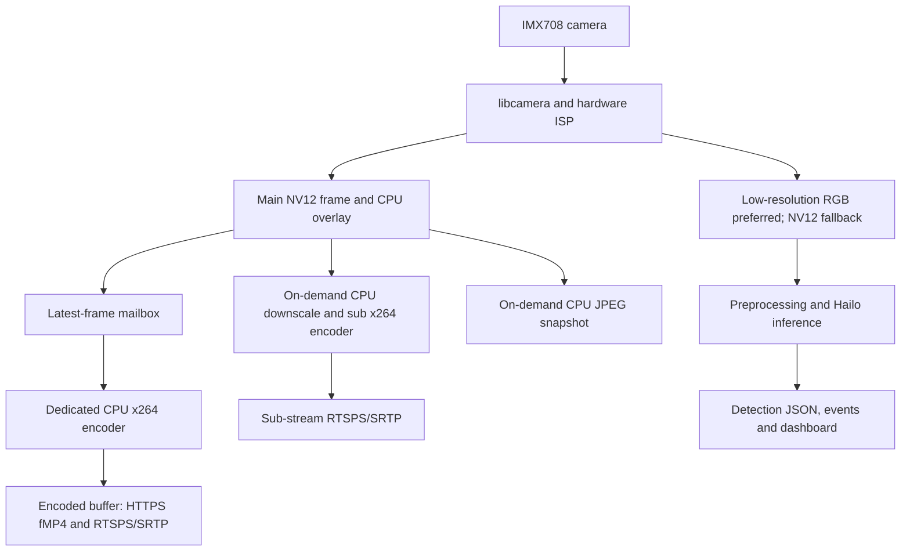

# rpi-cam-hailo Camera Firmware

**rpi-cam-hailo** is the application firmware for an embedded Linux network
camera built around **Raspberry Pi 5**, **Camera Module 3 Wide (IMX708)** and
an optional **Hailo-8 AI accelerator**. A C++20 service captures and encodes
video, runs object detection, serves secure streams and manages the device.
Its React web UI provides setup, live viewing and administration.

This firmware and the companion
[**rpi-cam-bsp OS image project**](https://github.com/many9381/rpi-cam-bsp)
form one embedded system. The BSP supplies the bootable Yocto Linux image,
kernel, drivers and provisioning. This repository supplies the application
and UI running on that OS. The supported installation route packages both
into an SSD image with device-specific setup.

**Current status:** the integrated image has passed internal device
acceptance. Security features and TTA preparation evidence are documented;
this repository does **not** establish that the product holds TTA
certification. See [the status and evidence table](#tta-certification-preparation).

- **Users:** [first boot and everyday use](#first-boot-and-everyday-use)
- **System developers:** [Pi 5 architecture and limits](#raspberry-pi-5-architecture-and-limits)
- **Security reviewers:** [TTA certification preparation](#tta-certification-preparation)
- **Contributors:** [build and test](#build-and-test), [source layout](#source-layout)

## One system, two repositories

| Repository | Responsibility | Change it when you need to… |
|---|---|---|
| **rpi-cam-hailo** — this repository | Camera service, streaming, AI integration, web UI, access control, audit and integrity checks | Change application behavior, UI, APIs or application security |
| [**rpi-cam-bsp**](https://github.com/many9381/rpi-cam-bsp) | Yocto layers, kernel/driver integration, runtime libraries, image generation, SSD installation and provisioning | Change the OS, hardware support, packaged versions or device installation |

The BSP builds a pinned firmware revision plus reviewed layer patches.
A source checkout's current `HEAD` is not automatically the version shipped
in an image. Application fixes that depend on library or kernel changes must
be integrated and validated with the corresponding BSP changes. The
[RTSP session-isolation correction](docs/security/rtsp-session-isolation-remediation-2026-10-11.md)
is one example: it requires both application and GStreamer library changes.

## What the camera provides

| Capability | Behavior |
|---|---|
| Video | libcamera capture, software x264 H.264 encoding, HTTPS fragmented MP4 preview and JPEG snapshots |
| Secure streaming | RTSPS control with SRTP media, Digest authentication and main/sub-stream mounts |
| AI | HailoRT object detection; labels, confidence and processing status through the UI, JSON API and server-sent events |
| Overlay | Up to eight timestamp, camera-ID or custom-text items; rendered into the main video, snapshots and derived sub stream |
| Administration | Initial administrator setup, camera/encoder/sub-stream settings, users, roles and optional management IP restrictions |
| Protection | Password hashing, session controls, login rate limiting, audit rotation, signed integrity checks and restricted operation on verification failure |
| Web UI | Korean and English; served by the C++ service, with no Node.js server required on the device |

## First boot and everyday use

On a configured device, the camera service starts automatically at boot.
Use the browser to complete initial administrator setup, then sign in to
view video and manage the camera.

1. Find the Pi's current Ethernet or Wi-Fi address and open
   `https://<current-Pi-IP>:8443/`.
2. Sign in with the initial account displayed by the application and create
   the permanent administrator in the setup wizard.
3. Check live video. With Hailo enabled, also check `hailo / ready`, an
   increasing processed-frame count, and object names with confidence values.
4. Use the dashboard to adjust camera, overlay and sub-stream settings.
   Users, access rules, audit records and system protection have their own
   administration pages.

The Pi's future DHCP address does not need to be registered during setup.
Management IP restrictions default **off** for new web setup; authentication
is still required. An optional allowed address is a **client PC's address**,
not the Pi's server address. Manage this policy in **Users → Access IPs**.
Enabling it requires the current administrator's address in the allowed list.

Sessions remain bound to the login client's IP, so moving that client to
another network can require another login. Reboots preserve accounts and
settings. **A full SSD reflash replaces them and requires setup again.**
An application update that preserves its security database has a different
state-preservation boundary; see [setup and access policy](docs/security/dhcp-setup-2026-10-11.md).

The default bootstrap TLS certificate is self-signed for `camera.local`.
It does not create DNS/mDNS records, and direct IP access can produce trust
or name warnings. For trusted TLS access, provision a resolvable name and a
matching trusted certificate using the
[BSP provisioning guide](https://github.com/many9381/rpi-cam-bsp/blob/feature/root-firmware-layers/docs/runbooks/camera-firmware.md#device-provisioning).

Stream addresses are:

- Browser preview and snapshots: provided by the authenticated dashboard.
- Main RTSPS stream: `rtsps://<device>:8555/imx708/main`.
- Sub stream: `rtsps://<device>:8555/imx708/sub`, when enabled.

Use an RTSPS/SRTP-compatible client; the documented interoperability tests
use GStreamer. Initial administrator setup creates the RTSP Digest
credential. The `rtsp-digest-credential` tool supports explicit provisioning.

## Raspberry Pi 5 architecture and limits

### The missing accelerator is the video encoder

Raspberry Pi 5 has **no hardware H.264 encoder**. This is confirmed by a
[Raspberry Pi engineer](https://forums.raspberrypi.com/viewtopic.php?t=367583).
The official [camera software documentation](https://www.raspberrypi.com/documentation/computers/camera_software.html#low-latency-video-with-raspberry-pi-5)
also describes its software-encoding latency trade-offs.

Image processing still uses the **hardware image signal processor (ISP)**
through libcamera, and **Hailo-8 accelerates inference** when installed.
The GPU and Hailo device do
not provide an H.264 encoder for this pipeline. Installing another codec
plugin cannot add the missing dedicated encoder; the shipped path uses x264
on the Arm CPU.

The comparison below is with embedded camera SoCs that provide dedicated
video-processing blocks. Capabilities and vendor SDKs vary by platform.

| Stage | Camera SoC with dedicated video blocks | This implementation on Pi 5 |
|---|---|---|
| Sensor and image processing | Sensor → ISP → image buffers | IMX708 → libcamera/CFE/PiSP → image buffers; ISP acceleration remains in use |
| H.264 compression | A hardware video encoder consumes frames | A CPU x264 worker compresses the main stream |
| Secondary stream | May have hardware scaling and an additional encoder channel | CPU NV12 downscaling plus a separate x264 worker, activated by sub-stream demand |
| Text overlay and JPEG | May be handled by dedicated media blocks | CPU overlay compositor and libjpeg snapshot encoding |
| AI | A separate NPU/DSP or CPU path, depending on the SoC | ISP low-resolution output → preprocessing → Hailo-8; AI and video encoding have separate workloads |
| Buffer hand-off | Vendor DMA/fence APIs may connect hardware stages | Shared frame leases keep capture buffers alive across CPU consumers; this is not an end-to-end zero-copy pipeline |

### How that changes the software design



1. **Capture does not wait for H.264 encoding.** The capture callback hands a
   frame to a dedicated encoder thread. A one-slot mailbox replaces an
   unconsumed frame with the newest one, releasing the stale frame. When
   encoding falls behind, encoded frame rate can drop instead of growing an
   ever-longer queue. See [CameraPipeline](src/media/CameraPipeline.cpp) and
   [EncodeMailbox](include/camera_firmware/media/EncodeMailbox.hpp).
2. **Buffer ownership is explicit.** Snapshots, encoding and AI can outlive a
   capture callback. A [FrameLease](include/camera_firmware/media/FrameLease.hpp)
   delays requeueing the camera request until its consumers finish. CPU
   mapping and compressed-output copies still exist. A hardware-encoder port
   must account for its own buffer formats, synchronization and lifetime rules.
3. **AI preprocessing uses the ISP where possible.** A low-resolution RGB
   stream avoids CPU color conversion when accepted by libcamera. The code
   falls back to low-resolution NV12 conversion, then to the main stream if
   necessary. AI takes frames when ready rather than holding a capture buffer
   between inferences. See [preprocessing](src/ai/Nv12RgbPreprocessor.cpp).
4. **A sub stream has a real CPU cost.** The
   [sub-stream tap](include/camera_firmware/media/SubStreamTap.hpp) requests
   work only while active clients need it. The
   [sub-stream encoder](src/media/SubStreamEncoder.cpp) scales and encodes on
   the CPU; adding a stream is not a free hardware channel.
5. **Overlay and output sharing happen before transport.** Text is stamped
   into the main frame before readers receive it, so snapshots and both video
   streams share the overlay. Main H.264 output is reused for MP4 and RTSP
   delivery; each viewer does not need its own main-stream encoder.

The [reference configuration](config/app-rpi5-dev.yaml) requests
**1920×1080 at 50 fps**. Treat capture rate, encoded output rate and inference
rate as separate measurements.
CPU load, scene complexity, x264 preset, additional streams, snapshots,
network clients and cooling affect the result. A successful capture check
is not a guarantee of sustained 50 fps encoding under every workload.
The dashboard exposes capture/encoded rates and encode time to make this
visible. Endurance testing is outside the agreed validation scope.

For another embedded platform, the application/security layers can be reused,
but the media integration needs a deliberate port: capture API and formats,
encoder implementation, buffer synchronization, scaling/overlay and driver
packaging must be assessed. A vendor hardware encoder is not a drop-in
replacement for the current x264 worker.

## TTA certification preparation

**Status as of 2026-10-17: security implementation and internal validation
are documented; formal TTA certification is not established.** No issued
certificate or complete external certification test report is recorded in
this repository. The following is an engineering progress summary, not a
percentage of certification completed or a declaration of conformity.

TTA is the Telecommunications Technology Association. The project organizes
its source-weakness and known-vulnerability evidence as **TTA 10.1** and
**TTA 10.2**. Those labels follow the repository's evidence scheme; they do
not replace the full applicable criteria and evaluation procedure from the
[TTA service portal](https://cs.tta.or.kr/tta/main/main.do).

| Work area | Recorded progress | Evidence and boundary |
|---|---|---|
| Accounts and access control | Setup, password policy, roles, session expiry, recent-authentication checks and optional IP policy implemented and regression-tested | [DHCP-safe setup](docs/security/dhcp-setup-2026-10-11.md) and [setup recovery](docs/security/setup-session-recovery-2026-10-12.md); deployment policy still matters |
| Secure transport and session isolation | HTTPS and RTSPS/SRTP implemented; the identified RTSP session-isolation defect was corrected in both app and library | [October 11 deployment tests](docs/security/rtsp-deployment-validation-2026-10-11.md): 170 RTSP unit/integration tests and authenticated encrypted-video verification; historical evidence for that image |
| Audit and self-protection | Bounded audit storage, integrity signatures, security self-tests and restricted-state handling implemented with automated coverage | [Audit tests](tests/unit/security/AuditLogServiceTest.cpp), [protection tests](tests/integration/SystemProtectionIntegrationTest.cpp) and [quality gate](docs/security/static-analysis-2026-10-15.md); application integrity checks do not establish hardware secure boot |
| TTA 10.1 — source weaknesses | Formatting and clang-tidy gate implemented; October 16 review covered 79 product translation units with **0 errors and 198 remaining warnings** | [Warning review and dispositions](docs/security/static-warning-review-2026-10-16.md); zero gate errors is not zero findings |
| TTA 10.2 — known vulnerabilities | Package/SPDX inventory, web SBOM, source/backport assessments, remediation and consumer reviews recorded | [Security evidence index](docs/security/README.md) and [residual review](docs/security/consumer-boundary-review-2026-10-16.md); open, partial and unassessed findings remain |
| Integrated OS and firmware | October 17 image accepted: 391 readable installed-file hashes, three Wi-Fi reboots, capture progress and operator-confirmed video/Hailo results | [Current deployment record](docs/security/buildtools-deployment-validation-2026-10-17.md); this is functional/device acceptance, not an external certification result |
| Formal certification | No certificate or complete external evaluation result documented | A complete mapping to the applicable criteria, the evaluated product/configuration and external results is not established by these engineering records |

The **October 15 full quality run** recorded 1,356 CTest passes, 10 explicit
hardware skips and 770 web-test passes. The **October 16 selective follow-up**
recorded 361 selected target-test passes and reduced the warning count to
198. These are separate runs; the full source suite was not rerun during
October 17 device acceptance.

The last residual advisory ledger, reviewed on October 15–16, retained
**11 open, 3 partially mitigated/open and 1 unassessed association** for its
recorded image/source baseline. This is not a fresh vulnerability count for
the October 17 image with development packages removed. Preserve the dated
assessments and their applicability conditions; successful video operation
cannot close a vulnerability finding.

The reviewed libevent camera paths and HailoRT fixed-pattern `glob` task are
[complete with no further implementation currently assigned](docs/security/consumer-boundary-review-2026-10-16.md#product-work-status).
Endurance testing, additional MOV/common-allocator redesign and separate
validation of the development-tools image remain
[excluded by agreement](docs/security/README.md#agreed-work-exclusions).
Exclusions describe scope; they do not count as certification passes.

The current image is a development baseline: bootstrap certificates,
optional access restrictions, development utilities and personal login
restoration must be distinguished from any future evaluated deployment
configuration. Use the [security evidence index](docs/security/README.md)
for dated reports, unresolved dispositions and exact image/package evidence.

## Validated platform

The current accepted integrated image is **`20261017T051814Z-63b1d2587b1b`**,
profile `rpi5-camera-hailo`. Its [deployment report](docs/security/buildtools-deployment-validation-2026-10-17.md)
records what was measured and what the operator confirmed.

| Component | Validated image or build requirement |
|---|---|
| Hardware | Raspberry Pi 5, Camera Module 3 Wide, USB SSD, Hailo-8 |
| OS | Yocto 6.0 (`wrynose`), AArch64, kernel `6.18.55-v8-16k` |
| Capture stack | Raspberry Pi libcamera `0.6.0+rpt20251202`, matched to downstream CFE/ISP drivers |
| AI stack | HailoRT and PCIe driver 4.24.0; a compatible checksum-pinned HEF model |
| C++ build | C++20, CMake 3.25+; image cross-built with Yocto GCC 15.3.0 |
| Web build | Node.js `^20.19.0` or `>=22.12.0` and npm, per `web/package.json`; build-time only |
| Installed development tools | Target GCC/G++, CMake, Ninja and development headers absent by default; required `libgcc`/`libstdc++` runtime libraries retained |

The BSP also offers a camera profile without Hailo. Earlier Raspberry Pi OS /
Debian development used a different kernel and libcamera stack; its
[dependency inventory](docs/security/dependency-inventory.md) is historical.
Use the actual image manifest/SPDX for installed package versions.

## Build and test

### Build the complete appliance with Yocto

Use the [BSP build instructions](https://github.com/many9381/rpi-cam-bsp#build-and-install)
to prepare the host, source access, Hailo packages/model, Wi-Fi and SSD inputs.
Run from the **BSP repository root**, not this firmware directory:

```bash
./scripts/build-image.sh
./scripts/install-ssd.sh --check
# Replaces the registered SSD with the latest completed image:
./scripts/install-ssd.sh
```

In a combined workspace this repository is checked out as `rpi-cam-hailo/`.
Application, web assets and the optional editable source checkout are separate
packages. Update the BSP source pin/patches deliberately when integrating
firmware changes. The web recipe builds offline with host Node.js. Neither
routine image generation nor installation requires a QEMU image.

### Build the application from source

This route is for a suitably provisioned development system or target
sysroot. The default installed camera image intentionally omits build tools.
Required development libraries include libcamera, GStreamer core/app/RTSP
and RTSP server, libsrtp2 2.7+, x264, libavutil, libswscale, OpenSSL, SQLite3,
yaml-cpp, jsoncpp, libjpeg and GLib/GIO; include HailoRT headers/libraries for
a Hailo build. libcamera must match the target kernel's camera drivers.

CMake copies and patches exact, clean source checkouts of Drogon 1.9.0 and
Trantor 1.5.20, validated by revision in
[Dependencies.cmake](cmake/Dependencies.cmake). Configure and build:

```bash
cmake -S . -B build \
  -DCAMERA_FIRMWARE_DROGON_SOURCE_DIR=/path/to/drogon-1.9.0 \
  -DCAMERA_FIRMWARE_TRANTOR_SOURCE_DIR=/path/to/trantor-1.5.20 \
  -DBUILD_TESTING=ON
cmake --build build -j4
ctest --test-dir build --output-on-failure -j2
```

The default build also builds the web assets with npm. The default
`RelWithDebInfo` configuration keeps assertions enabled and writes
`compile_commands.json`. Configure the intended integrity public key with
`CF_INTEGRITY_PUBLIC_KEY_FILE` for deployment builds; CMake's bundled key is
for development. The BSP handles its own signing identity integration.

To run the quality gate from this repository's root:

```bash
tools/ci/check.sh
# Optional local pre-commit format hook:
tools/ci/install-hooks.sh
# Web tests alone:
(cd web && npx vitest run)
```

The gate runs formatting, clang-tidy, the C++ build/tests and web tests/build.
Its error families include `bugprone-*`, `cert-*`, `clang-analyzer-*` and
`concurrency-*`. [CI](.github/workflows/ci.yml) is configured for a prepared
self-hosted ARM64 runner. Hardware tests require their documented opt-in
conditions; skipped tests are not passes.

## Configuration and APIs

The base YAML defines `platform`, `camera`, `http`, `security`,
`self_protection`, `ai` and `secure_rtsp`. Validate it with
`camera-firmware --validate-config <file>`.
[Development examples](config/) are starting points and may disable TLS or
authentication; the provisioned Yocto configuration is the supported
appliance setup.

Camera, sub-stream and OSD settings changed through the web are persisted
under the security state directory and applied over the base YAML, with
validation and rollback handling. Integrity protection covers the application
binary, base configuration and kernel. Changing a covered file requires a
new signed manifest; normal app-managed mutable settings do not. The Yocto
kernel path is `/boot/kernel_2712.img`. See the
[BSP provisioning guide](https://github.com/many9381/rpi-cam-bsp/blob/feature/root-firmware-layers/docs/runbooks/camera-firmware.md#device-provisioning)
for signing and device material.

All API groups are under `/api/v1`:

| Group | Examples |
|---|---|
| Setup and authentication | `setup/status`, `setup/initialize`, `auth/login`, `auth/reauthenticate` |
| Camera and AI | `cameras`, `cameras/{id}/live.mp4`, `cameras/{id}/snapshot.jpg`, `ai/detections`, `ai/detections/stream` |
| Runtime configuration | `settings/runtime`, `settings/runtime/apply`, `runtime/restart` |
| Administration and protection | `security/users…`, `security/management-ips…`, `audit/events`, `system/protection`, `system/integrity-checks` |

Direct HTTPS origin checks use the actual server socket address, port and
TLS state. `http.public_base_url` can be empty for DHCP, or allow an explicit
additional HTTPS origin. Arbitrary `Host` or forwarded headers do not grant
access. Origin validation is separate from certificate trust/name validation.

## Source layout

| Path | Contents |
|---|---|
| `apps/camera-firmware/` | Service executable and live MP4 delivery |
| `apps/camera-firmware-integrity/`, `apps/rtsp-digest-credential/` | Signing/manifest and RTSP credential tools |
| `src/`, `include/camera_firmware/` | Capture, media, AI, runtime, security, integrity, settings and service modules |
| `plugins/gst-secure-srtp/` | GStreamer SRTP encoder using firmware-owned keys |
| `web/` | React/TypeScript UI, unit tests and browser-test definitions |
| `config/` | Development configuration examples |
| `cmake/`, `patches/` | Dependency integration and Drogon/Trantor patches |
| `tests/` | C++, CMake and integration tests |
| `tools/ci/`, `tools/security/` | Quality gate, hooks, SBOM and vulnerability tooling |
| `docs/security/` | Dated security and device evidence, with a current-status index |
| `vendor/` | Third-party resources, including the embedded font |

## Dependencies and licensing

Runtime dependencies include libcamera, GStreamer, HailoRT when enabled,
x264, libsrtp2, FFmpeg libavutil/libswscale, Drogon/Trantor, OpenSSL, SQLite,
yaml-cpp, jsoncpp, libjpeg and GLib. The web uses React, react-router and
Vite; exact versions are in `web/package-lock.json`. `stb_truetype` and the
NanumGothic Bold font are included under `vendor/`; the font uses the SIL
Open Font License.

No project-wide license file is included yet. Third-party notices and
licenses remain applicable. Image redistribution must also follow the BSP's
[H.264 licensing gate](https://github.com/many9381/rpi-cam-bsp/blob/feature/root-firmware-layers/docs/licensing/camera-h264.md).
Keep credentials, raw device evidence, actual deployment addresses and device
identifiers outside Git; publish sanitized reports only.
